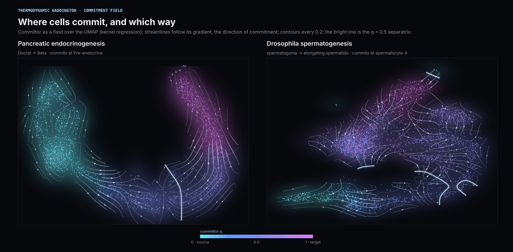

# Introduction

C. H. Waddington pictured development as cells rolling downhill into fates [1]. Single-cell transcriptomics and RNA velocity [2, 3] have made that picture quantitative: scVelo estimates the direction of each cell's transcriptional change [3], CellRank turns velocity into fate probabilities [4], Palantir orders differentiation [5], and Waddington-OT links stages by optimal transport [6]. These methods answer *where* a cell is going. They leave open a distinct, physically meaningful question: *how far from equilibrium is the journey?* A process can be ordered yet close to equilibrium, or strongly driven and dissipative. The difference is entropy production, a central quantity of stochastic thermodynamics [7], and in a Markovian description it is carried entirely by probability currents that circulate around cycles of states [8].

Measuring this from single-cell data is harder than it looks, and this paper is about why. RNA velocity supplies a per-cell drift, so it is tempting to estimate an entropy-production rate from it and test the result against velocity shuffled across cells. We show that such a test is significant on fields that are exactly at equilibrium: shuffling destroys the coupling between velocity and position, not detailed balance, so the test detects coherent flow rather than irreversibility. A calibrated replacement exists. A discrete Hodge decomposition splits the velocity flow on a cell graph into a gradient part, which is reversible, and a cyclic part, which circulates and breaks detailed balance [9]. Its cyclic fraction is calibrated on ground truth. But it, too, fails in a second, subtler way: measured velocity is noisy, noise looks cyclic, and against the usual noise-free reversible reference, noisy equilibrium data reads as circulating every time.

We make three contributions. First, a calibrated irreversibility readout that is robust to velocity noise and sequencing depth: a *noise-matched null* built from each dataset's own reversible flow and residual noise, with its bias removed by a parametric double bootstrap. Second, a thermodynamic commitment coordinate, the transition-path-theory committor [10], with a free-energy barrier in units of kT along it. Third, an application to four developmental lineages in two phyla, including Drosophila spermatogenesis, for which we build spliced and unspliced counts from the Fly Cell Atlas [11] raw reads. We report negative and dataset-dependent results alongside positive ones; everything is open, tested, and reproducible in one command.

# Results

## A thermodynamic layer for trajectory analysis

The pipeline takes expression and RNA velocity, from scVelo or a spliced-minus-unspliced proxy, and builds an exact k-nearest-neighbour graph of cells in principal-component space (Fig. 1). The velocity induces a flow along every edge, from which three readouts follow: (i) the Hodge decomposition of that flow into reversible and irreversible parts, read against a noise-matched null; (ii) the committor between chosen progenitor and terminal states, and the potential of mean force along it; and (iii) a Jarzynski path-work free-energy landscape [12] placed on a kT scale by a density-anchored Boltzmann inversion. The pipeline complements, rather than replaces, existing trajectory tools.

{width=100%}

## A common style of irreversibility test is miscalibrated

We first built ground truth with known entropy production: a linear diffusion $dx = -Bx\,dt + \sqrt{2D}\,dW$ with $B = aI + \omega J$, which is at equilibrium for $\omega = 0$ and produces entropy growing as $\omega^2$ otherwise. A Seifert pair-flux entropy-production rate tested against velocity permuted across cells was significant at $\alpha = 0.05$ in every equilibrium run (false-positive rate 1.00) and separated equilibrium from driven fields worse than chance (AUROC 0.44; Fig. 2). A direction-only velocity-coherence score also failed (AUROC 0.53), because both kinds of field are coherent. On real pancreas data the same test separates true from shuffled velocity with AUROC 1.00, which is exactly the problem: any statistic sensitive to velocity-position coupling does so, whether or not detailed balance is broken.

The Hodge cyclic fraction behaves as a calibrated measure should. It is low and flat at equilibrium (0.12, the finite-graph floor) and rises monotonically with the drive (0.15, 0.25, 0.47, 0.72, 0.85 for $\omega$ = 0.25 to 4), separating equilibrium from driven fields with AUROC 1.00 (Fig. 2). Schnakenberg cycle affinities in kT [8], computed from a spanning-tree potential, are likewise zero for conservative fields and monotonic in the drive.

![**A common irreversibility test is miscalibrated; the Hodge cyclic fraction is not.** Ground truth: linear diffusion with rotational drive $\omega$ (true entropy production zero at $\omega = 0$), 400 cells, 15 seeds. Left: the cyclic fraction rises monotonically with the drive from a flat equilibrium floor, while velocity coherence cannot tell the fields apart. Right: AUROC for separating equilibrium from driven fields; the velocity-shuffle entropy-production test scores 0.44 and is significant in every equilibrium run.](../figures/synthetic_ground_truth.png){width=100%}

## Velocity noise masquerades as circulation

The cyclic fraction is read against a reversible reference on the same cells, because a finite graph gives a small non-zero fraction even for a perfect gradient field. The usual reference is a clean radial gradient field. Real velocity is noisy, and noise, being uncorrelated between neighbours, is mostly cyclic. Adding measurement noise to the ground truth, uniform or uneven (half the cells ten times noisier than the other half, as for shallow-sequenced cells), the excess over the clean floor false-positived in every equilibrium run at every non-zero noise level (Fig. 3).

We therefore build the null from the data itself. We fit a node potential $U$ to the work along every edge by least squares, and take its local gradient as a reversible per-cell velocity; we take each cell's residual noise as its velocity minus its neighbourhood mean; and each null field is the reversible velocity plus residuals re-drawn from neighbouring cells with random signs. Because each null field passes through the identical edge-flow and Hodge steps as the data, it carries both the graph's discretisation floor and the dataset's own noise. Running the identical procedure on reference datasets that are reversible by construction estimates the method's own small bias, which is subtracted (a parametric double bootstrap; Methods).

Across 200 ground-truth runs (5 drives, 4 noise settings, 10 seeds), the noise-matched excess had a false-positive rate of 0.00 at equilibrium at every noise level, against 1.00 for the clean-floor excess at every noise level with noise; pooled over noise levels, AUROC for equilibrium versus driven rose from 0.76 to 0.96 (Fig. 3). A noisy equilibrium field outranked a clean weak drive in 100% of comparisons for the clean-floor excess and 0% for the noise-matched excess. Per cell, under uneven noise at equilibrium, the clean-floor excess in the noisy half was +0.46 and the noise-matched excess $-0.001$. Power falls with noise, as it should: under heavy uneven noise a weak drive is no longer detectable, while strong drives remain so.

![**Velocity noise masquerades as circulation; a noise-matched null removes it.** Ground truth with measurement noise: none, uniform, uneven (half the cells 10x noisier), and uneven-high; 5 drives x 4 noise settings x 10 seeds. Left: excess over a clean radial floor rises with noise even at equilibrium ($\omega = 0$). Middle: the noise-matched excess is about zero at equilibrium at every noise level and rises with the drive, with power decreasing as noise grows. Right: pooled AUROC, equilibrium versus driven.](../figures/noise_matched_ground_truth.png){width=100%}

## Four lineages in two phyla are reversible within their own noise

We applied both readouts to three vertebrate lineages, using the same setup throughout (1,500 cells, 100 genes, proxy velocity, five subsamples): mouse pancreatic endocrinogenesis [13], mouse gastrulation erythropoiesis [14] and human bone marrow erythropoiesis [5]; and to Drosophila spermatogenesis (below). Against the clean floor, pancreas showed a small excess (+0.051), and an earlier version of this work reported it as modest real circulation. Against the noise-matched null, it is $-0.011$ (z = $-1.0$). No lineage circulates beyond its own noise (Table 1, Fig. 4). On pancreas, scVelo dynamical velocity gives the same reading as the proxy.

| lineage | cyclic fraction | clean floor | excess over clean floor | noise-matched excess (z) |
|---|---|---|---|---|
| mouse pancreatic endocrinogenesis | 0.151 | 0.099 | +0.051 | $-0.011$ ($-1.0$) |
| mouse gastrulation erythropoiesis | 0.080 | 0.085 | $-0.005$ | $-0.005$ ($-0.5$) |
| human bone marrow erythropoiesis | 0.108 | 0.097 | +0.012 | $-0.010$ ($-0.8$) |
| Drosophila spermatogenesis (germline) | 0.097 | 0.086 | +0.011 | $-0.007$ ($-0.6$) |

: **Table 1.** Calibrated irreversibility of four developmental lineages. Cyclic fraction of the velocity flow, the clean reversible floor on the same cells, and the noise-matched excess with its z-score. Shuffled-velocity ceilings are 0.29 to 0.52.

The reading is a property of the measurement as well as of the biology, and we state its limit. These lineages are nearly one-dimensional, and a one-dimensional structure has few cycles to carry circulation: injecting a known rotation into the real pancreas geometry barely moves the noise-matched excess, even at the strongest drive (+0.010, z = 1.0). The result is therefore "no circulation detected beyond noise", not proof of zero circulation. It is consistent with differentiation as descent on a landscape, with an arrow of time carried by the committor rather than by circulating currents.

{width=82%}

## A commitment coordinate and a barrier in kT

Given progenitor and terminal states, the forward committor $q(x)$ is the probability that a cell at $x$ reaches the terminal fate before returning to the progenitor: the principled reaction coordinate of transition-path theory [10]. On pancreas (Ductal to Beta), it recovers the lineage order without supervision (Ductal, Ngn3, Pre-endocrine, Beta) and crosses 0.5 at the Pre-endocrine stage. The potential of mean force $F(q) = -k_BT \ln P(q)$ along it gives a commitment barrier of 1.6 kT [1.4, 1.9] across eight subsamples of 400 cells, with the transition state at $q \approx 0.43$ (Fig. 5). A density-anchored Boltzmann inversion places the landscape about 5 kT deep; its low agreement with the path-work landscape ($R^2 \approx 0.14$) quantifies flow structure that a density landscape cannot see.

Ordering is dataset-dependent and we report it as such. On pancreas the committor ranks developmental stage better than the first principal component (Spearman 0.94 $\pm$ 0.02 vs 0.89; 10/10 subsamples; paired Wilcoxon $p = 0.002$), but on gastrulation the first principal component wins (0.94 vs 0.81), and in a like-for-like comparison at 2,000 pancreas cells CellRank's two-boundary absorption probability orders best (0.99, against 0.95 for the committor and 0.94 for PC1). The committor's value is as a commitment coordinate tied to the thermodynamics, not as a better pseudotime.

![**A commitment barrier in kT.** Potential of mean force along the committor from Ductal progenitors ($q = 0$) to Beta cells ($q = 1$) in pancreatic endocrinogenesis; eight subsamples (thin) and mean (thick). The barrier is 1.6 kT [1.4, 1.9], with the transition state at $q \approx 0.43$.](../figures/commitment_barrier.png){width=88%}

## Drosophila spermatogenesis from raw reads

To test the framework outside vertebrates, we turned to the Drosophila male germline in the Fly Cell Atlas [11], which runs from spermatogonia through the spermatocyte programme to elongating spermatids. The atlas publishes no spliced/unspliced layers, so we built them: we streamed an evenly spaced sample of 61.8 million reads (about 10% of library FCA59) out of the unaligned 10x BAMs at ArrayExpress E-MTAB-10519 over HTTP range requests, quantified nascent and mature RNA with kallisto | bustools [15] against Ensembl BDGP6.46 (88.6% of reads pseudoaligned), and matched all 15,292 atlas cells of the library by barcode. Genes carry FlyBase identifiers. The analysis uses 7,335 germline cells with the atlas annotation as stage labels.

The velocity passes a biological check (Fig. 6D): the unspliced fraction falls from 0.19 in spermatocytes to 0.04 in spermatids, the known shutdown of transcription after meiosis in Drosophila, recovered from reads we quantified. The committor orders the sixteen germline stages with Spearman 0.78 $\pm$ 0.05, against 0.47 for the first principal component, winning in 8/8 subsamples (Fig. 6A), and places commitment within the spermatocyte programme in 7/8 subsamples; the barrier is 2.1 kT [1.6, 2.6] (Fig. 6B). The flow is reversible within its noise (Table 1, Fig. 6C).

Two per-cell artifacts surfaced and were removed. The per-cell cyclic flow *energy* first showed a seven-fold "peak" of circulation in late spermatocytes; because it is an energy it grows with velocity magnitude, and across stages it tracked sequencing depth (Spearman +0.84). A magnitude-invariant local cyclic fraction removes it. Against the clean floor, post-meiotic spermatids then showed an excess of +0.12 that ran opposite to depth ($-0.77$) and to the unspliced fraction ($-0.75$), appearing exactly where the velocity signal vanishes; against the noise-matched null it is $-0.010$, and the per-stage noise-matched excess no longer tracks depth (+0.06).

Genes whose expression switches as cells cross $q = 0.5$ form a reproducible ranking: top-50 lists from independent committor fits overlap by 0.36, against 0.011 expected by chance (Fig. 6E, F; FlyBase-linked). A list of canonical spermatocyte-programme regulators fixed before the analysis (tMAC and tTAF components, bam, bgcn, and spermatid genes) is not enriched in it (0 of 14 in the top 5%), consistent with those regulators acting where the spermatocyte programme begins rather than where it ends; we report the ranking as candidates for perturbation, not as causal evidence.

![**Drosophila spermatogenesis (Fly Cell Atlas), velocity built from raw reads.** (A) Committor on the atlas UMAP, from spermatogonia ($q = 0$) to late elongating spermatids ($q = 1$). (B) Potential of mean force along the committor, eight subsamples. (C) Cyclic fraction against the clean floor and shuffled ceiling, beside the three vertebrate lineages. (D) Velocity check: the unspliced fraction collapses after meiosis; per-stage local excess against the clean floor (grey) and against the noise-matched null (teal). (E, F) Genes that switch on and off across $q = 0.5$ with the same sign in all five independent fits; candidates for follow-up, not causal.](../figures/fly_testis.png){width=100%}

## Commitment geometry, cell by cell

The per-cell export carries each cell's committor, phase, free energy and noise-matched local irreversibility at its embedding coordinates, so the commitment geometry can be read on the atlas map itself. Two descriptive views follow (Figs. 7, 8). A density pseudo-potential $U = -\ln(p/p_{\max} + 0.04)$ over the UMAP, coloured by a kernel-smoothed committor, shows each lineage as a landscape whose valleys hold the cells, with the $q = 0.5$ separatrix traced on it. The committor as a field, with streamlines of its gradient, shows where cells commit and in which direction: in pancreas the separatrix crosses the bridge between the Ductal and endocrine arms, and in the fly germline it lies within the spermatocyte band, where the export places commitment (spermatocyte 4). Both views are descriptive: the pseudo-potential is a density, not the path-work landscape, and both inherit the distortions of a two-dimensional embedding.

The barrier needs care in how it is compared (Fig. 9). Resampling the cells of one fit gives a narrow band: 2.70 kT [2.56, 2.85] for the 1,500-cell pancreas export and 3.81 kT [3.55, 4.24] for the 3,000-cell fly export. Both sit above the values reported earlier, and the reason is resolution: the KDE bandwidth shrinks as $n^{-1/5}$, so the estimated barrier rises with the number of cells. Subsampling the pancreas export to 400 cells, the size used for Fig. 5, gives 1.5 kT, in line with 1.6 kT [1.4, 1.9]; at 1,500 cells it is 2.7 kT. In the fly germline the dependence is weaker (3.7 kT at 1,500 cells against 3.8 kT at 3,000), but the eight independent 1,500-cell fits give 2.1 kT [1.6, 2.6], so the spread between fits is larger than the resampling band of any one. Barrier heights are therefore comparable only at matched cell numbers and should be reported across independent fits; single-fit values, including those shown by the interactive panel, are illustrative.

{width=100%}

{width=100%}

{width=100%}

# Discussion

The central result of this work is a calibration result, and it generalises beyond the method presented here. Two measurements that look like tests of irreversibility, a velocity-shuffle entropy-production test and a cyclic fraction read against a noise-free reversible reference, are both significant on data that is at equilibrium: the first because it detects coherent flow, the second because it detects noise. Each would have reported a discovery. Read against a null that carries the data's own noise, four developmental lineages in two phyla show no circulation beyond that noise. That reading agrees with the classical picture of differentiation as descent on a landscape, and it is the reading that the uncalibrated tests would have hidden. Thermodynamic claims about cell fate, in either direction, should be calibrated against the data's own noise.

The framework also gives fate commitment a physical scale. The committor locates where commitment happens and the potential of mean force along it gives a barrier in kT, comparable across systems at matched cell numbers (the estimate rises as the density bandwidth narrows with more cells); in Drosophila spermatogenesis the committor recovers the stage order far better than a principal-component axis and locates commitment within the spermatocyte programme, and the switching genes are a ranked, FlyBase-linked list for perturbation. Drosophila is a particularly good system to test that prediction, because stage-specific drivers and RNAi lines make the preregistered experiment (perturbing at the transition state versus the progenitor) practical.

The limits are stated plainly. The free energy is a density-anchored pseudopotential in units of kT, not a molecular free energy. The commitment barrier depends on the number of cells it is estimated from, and the spread between independent fits exceeds the resampling band of any one fit. Power to detect circulation on nearly one-dimensional lineages is low, so a null result means "not detected", not "absent". Most results use a spliced-minus-unspliced velocity proxy, with dynamical-velocity checks on pancreas; the Drosophila analysis uses one library at about 10% of its reads; the committor's ordering advantage is dataset-dependent and CellRank orders the pancreas lineage better; and the legacy entropy-production signal did not replicate on dentate gyrus neurogenesis across seven tests, a negative result we retain. These limits are part of the result: a method that reports where it fails is more useful than one that does not.

# Methods

**Graph and edge flow.** Expression is projected onto its leading principal components (six by default) and velocity onto the same axes. An exact k-nearest-neighbour graph ($k = 20$) is built with a KD-tree. For each undirected edge $(i, j)$ with unit direction $e_{ij}$, the edge flow is $f_{ij} = \tfrac{1}{2}(v_i + v_j) \cdot e_{ij}$.

**Hodge cyclic fraction.** With $B$ the oriented edge-node incidence matrix, any edge flow splits uniquely as $f = B\phi + c$, where $B\phi$ is the gradient (reversible) part and $c$, orthogonal to the range of $B$, is the cyclic part. $\phi$ is the sparse least-squares solution of $B\phi = f$ (LSQR, $O(\text{edges})$ per iteration). The irreversibility is $\lVert c \rVert^2 / \lVert f \rVert^2 \in [0, 1]$, scale-invariant and free of any rate model. The per-cell cyclic fraction is, over the edges incident to a cell, cyclic energy divided by cyclic plus gradient energy; it is invariant to velocity magnitude.

**Noise-matched null.** A node potential $U$ is fitted by least squares to the work along each edge, $U_j - U_i \approx \tfrac{1}{2}(v_i + v_j)\cdot(x_j - x_i)$, and the reversible velocity of cell $i$ is the least-squares gradient of $U$ over its neighbours. Residual noise is $r_i = v_i - \bar v_{N(i)}$, with $\bar v_{N(i)}$ the mean over the cell and its neighbours. A null field is $\tilde v_i = v^{\mathrm{rev}}_i + s_i\, r_{\pi(i)}$, with $\pi(i)$ drawn uniformly from the cell and its neighbours and $s_i = \pm 1$ at random. The null mean is taken over draws ($10$ by default). To correct the procedure's own bias, $R$ reference datasets ($5$ by default) are drawn the same way, which makes them reversible by construction; the identical procedure is applied to each, and the mean of (reference cyclic fraction minus its null mean) is subtracted. The excess is the observed fraction minus the null mean minus the bias, and $z$ divides it by the combined null and reference spread plus a systematic term of 0.01, the largest residual bias seen on ground truth. Per-cell excesses are computed the same way with the per-cell cyclic fraction.

**Cycle affinities.** Following Schnakenberg [8], the affinity of each fundamental cycle of the graph is computed in kT from a spanning-tree potential; it is zero for a conservative field (Kolmogorov's criterion) and grows with circulation.

**Legacy entropy production.** For comparison, Seifert's discrete-state pair-flux entropy-production rate is computed with bootstrap confidence intervals and a permutation null that shuffles velocity across cells [7].

**Ground truth.** Cells are sampled from the stationary distribution of $dx = -Bx\,dt + \sqrt{2D}\,dW$, $B = aI + \omega J$, with velocity $-Bx$ (400 cells). Measurement noise is Gaussian with standard deviation 0 ("none"), 0.5 ("uniform"), or 0.5 scaled by 3 and 0.3 in the two half-planes ("uneven"; 1.0 for "uneven-high"). Positives are $\omega > 0$ and negatives $\omega = 0$, pooled over noise levels; detection is $z > 2$.

**Committor and barrier.** With source and target cell sets, the committor solves the harmonic equation on the directed, landscape-weighted graph with $q = 0$ on the source and $q = 1$ on the target, by fixed-point iteration. The potential of mean force is $F(q) = -k_BT \ln P(q)$ with $P$ a kernel density along $q$; its maximum is the transition state and its height the barrier. Mean first-passage times follow Kemeny and Snell [16].

**Free-energy landscape and calibration.** Each velocity-aligned edge carries a path-work value combining a density ratio, the velocity drift along the edge and a diffusion term; effective free energies are propagated by multi-source Jarzynski exponential averaging [12]. The kT scale comes from a Boltzmann inversion $F = -k_BT \ln P$ of a kernel density of the embedding, and the $R^2$ between the two landscapes is reported.

**Datasets and velocity.** Pancreatic endocrinogenesis (E15.5) [13], gastrulation erythropoiesis [14] and human bone marrow [5] were obtained as scVelo datasets with spliced and unspliced layers. Unless stated, velocity is the spliced-minus-unspliced proxy on the 100 genes with the highest spliced variance; dynamical velocity is from scVelo [3]. For Drosophila, reads from library FCA59 of the Fly Cell Atlas [11] (ArrayExpress E-MTAB-10519; four sequencing runs) were streamed from evenly spaced byte ranges of the unaligned BAMs, converted to 10x v3 FASTQ, and quantified with kallisto | bustools in nascent/ambiguous/mature mode against Ensembl BDGP6.46; spliced counts are mature plus ambiguous and unspliced counts nascent. Cells were matched to the atlas annotation (10x, relaxed) by barcode.

**Commitment-driver genes.** Over five independent committor fits on random subsamples of 3,000 germline cells, each gene's switch score is the change in mean log-normalised expression between cells with $q \in [0.3, 0.5)$ and $q \in [0.5, 0.7]$, in units of its standard deviation. Genes are reported if the sign agrees in all fits; reproducibility is the mean overlap of top-50 lists between fits. The regulator list was fixed before the analysis was run.

**Statistics.** Results are means over seeded random subsamples, with standard deviations or 95% intervals as stated. Ordering is the absolute Spearman correlation with annotated stage; paired comparisons use the Wilcoxon signed-rank test.

# Data availability

All datasets are public: the scVelo pancreas, gastrulation and bone marrow datasets, and the Fly Cell Atlas testis (annotation from flycellatlas.org; raw reads at ArrayExpress E-MTAB-10519). The scripts that fetch and prepare them are in the repository.

# Code availability

The Thermodynamic Waddington Pipeline is open source under the MIT license at https://github.com/Cypherspec/Thermodynamic-Waddington-Pipeline. It installs with `pip`, is typed and lint-checked, has 233 unit tests run in continuous integration on Python 3.10 to 3.12, and reproduces every benchmark and figure with `python benchmarks/run_all.py`.

# Preregistration

A falsifiable test of the commitment prediction is preregistered in the repository (`PREREGISTRATION_commitment.md`): a perturbation applied at the transition state ($q \approx 0.5$) should change terminal-fate outcome more than the same perturbation at the progenitor state, with a pre-specified effect size, paired test and falsification criterion.

# References

1. Waddington, C. H. *The Strategy of the Genes* (Allen & Unwin, 1957).
2. La Manno, G. et al. RNA velocity of single cells. *Nature* **560**, 494-498 (2018).
3. Bergen, V. et al. Generalizing RNA velocity to transient cell states through dynamical modeling. *Nat. Biotechnol.* **38**, 1408-1414 (2020).
4. Lange, M. et al. CellRank for directed single-cell fate mapping. *Nat. Methods* **19**, 159-170 (2022).
5. Setty, M. et al. Characterization of cell fate probabilities in single-cell data with Palantir. *Nat. Biotechnol.* **37**, 451-460 (2019).
6. Schiebinger, G. et al. Optimal-transport analysis of single-cell gene expression identifies developmental trajectories in reprogramming. *Cell* **176**, 928-943 (2019).
7. Seifert, U. Stochastic thermodynamics, fluctuation theorems and molecular machines. *Rep. Prog. Phys.* **75**, 126001 (2012).
8. Schnakenberg, J. Network theory of microscopic and macroscopic behavior of master equation systems. *Rev. Mod. Phys.* **48**, 571-585 (1976).
9. Lim, L.-H. Hodge Laplacians on graphs. *SIAM Rev.* **62**, 685-715 (2020).
10. E, W. & Vanden-Eijnden, E. Towards a theory of transition paths. *J. Stat. Phys.* **123**, 503-523 (2006).
11. Li, H. et al. Fly Cell Atlas: a single-nucleus transcriptomic atlas of the adult fruit fly. *Science* **375**, eabk2432 (2022).
12. Jarzynski, C. Nonequilibrium equality for free energy differences. *Phys. Rev. Lett.* **78**, 2690-2693 (1997).
13. Bastidas-Ponce, A. et al. Comprehensive single cell mRNA profiling reveals a detailed roadmap for pancreatic endocrinogenesis. *Development* **146**, dev173849 (2019).
14. Pijuan-Sala, B. et al. A single-cell molecular map of mouse gastrulation and early organogenesis. *Nature* **566**, 490-495 (2019).
15. Bray, N. L., Pimentel, H., Melsted, P. & Pachter, L. Near-optimal probabilistic RNA-seq quantification. *Nat. Biotechnol.* **34**, 525-527 (2016).
16. Kemeny, J. G. & Snell, J. L. *Finite Markov Chains* (Van Nostrand, 1960).
